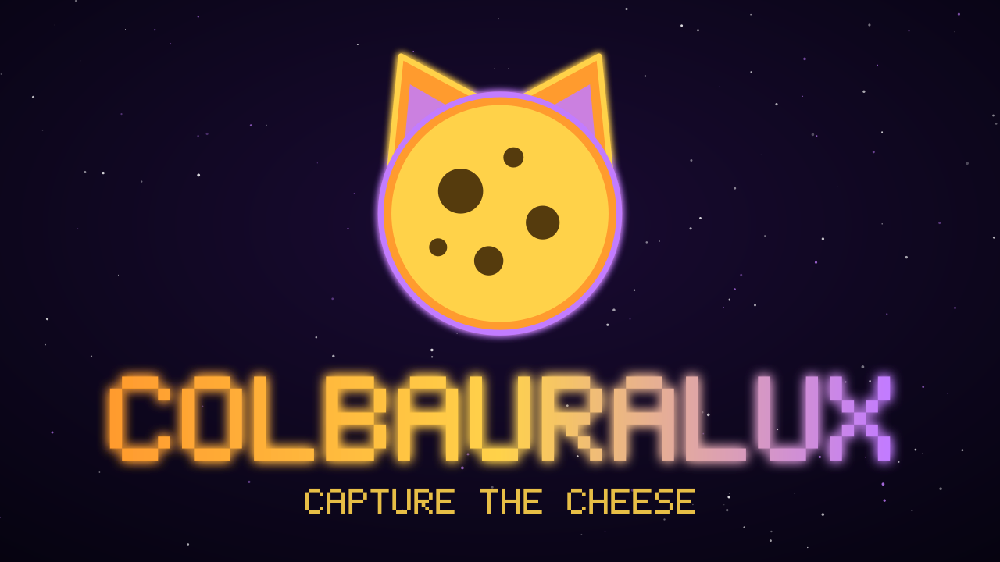

<p align="center"></p>

<p align="center">


</p>

# Colbauralux

A neon real-time strategy parody in the Colby Jack cat universe. You are **Colby**. Space is full of **Cheese Wheels**: capture them, stream kittens at rival rat and mouse factions, and take the Big Cheese. Everything (art, sound, music) is generated by code: no image files, no audio files, no dependencies, no bundler needed to play. Inspired by the 2011 iPad game Auralux.

**Play it:** the GitHub Pages site (`docs/site/`) hosts a playable build at `play/`.

## Quickstart

```sh
npm start            # serves the game at http://localhost:4796
npm test             # node:test suite
node tools/build-web.mjs   # single-file build -> dist/colbauralux.html
```

Open `index.html` through any static server (ES modules need http). Needs Node 22+ for the tools.

URL parameters: `?autostart=1` (skip title), `?level=N`, `?seed=N` (random skirmish), `?bot=1` (autopilot plays for you), `?debug=1` (unlock all levels).

## Controls

| Input | Action |
|---|---|
| Drag from your wheel | Swipe across your own wheels to add them, release on any wheel to send ships |
| Tap own wheel, then tap target | Select then send |
| Double-tap empty space / `A` | Select all your wheels |
| `Esc` | Clear selection |
| `1` `2` `3` `4` | Send 25 / 50 / 75 / 100 percent |
| `Space` / `P` | Pause |
| `F` | Cycle game speed |
| `R` / `N` | Restart / next level |
| `M` / `C` / `V` | Mute / CRT effect / fullscreen |

## Documentation

- [How to play](docs/HOW-TO-PLAY.md): rules, factions, tips
- [Architecture overview](docs/ARCH-OVERVIEW.md): sim, render, audio, UI, AI, with diagrams
- [Build and deploy](docs/BUILD.md): single-file build, Pages workflow, tests
- [How it was made](docs/HOW-IT-WAS-MADE.md): the parallel agent swarm story
- [Build timeline](docs/BUILD-TIMELINE.md): tracker stages, durations and Gantt chart
- [Build spec](docs/BUILD-SPEC.md): the full recipe to recreate this build from scratch
- [ARCHITECTURE.md](ARCHITECTURE.md): the binding module contract
- [Balance notes](docs/BALANCE.md), [Learnings](docs/LEARNINGS.md), [Swarm reports](docs/swarm/reports/)
- Site source: [docs/site/index.html](docs/site/index.html)

## Build timeline

<!-- TIMELINE:BEGIN -->
From the request to a **playable public site: 11m 42s** (04:33:28 to 04:45:10 UTC). Including the docs follow-up and redeploy: 13m 48s. The agent swarm itself took **7m 49s** (11 agents, 2.1x parallelism). Stage tables and details: [docs/BUILD-TIMELINE.md](docs/BUILD-TIMELINE.md).

**End to end**

```mermaid
gantt
    title Colbauralux end to end (UTC, 2026-11-22)
    dateFormat HH:mm:ss
    axisFormat %H:%M
    section Orchestration
    Request and setup (read tooling  scaffold  contract  SWARM.md) :Reques043328, 04:33:28, 04:36:17
    section Swarm
    Agent swarm (11 agents  see below) :crit, Agent043617, 04:36:17, 04:44:06
    Balance retune (levels 2-14  difficulty override) :Balanc043920, 04:39:20, 04:40:43
    Cheese-wheel art polish :Cheese044115, 04:41:15, 04:41:47
    section Ship
    Final gates  build rename  site links  commit and push :Final044406, 04:44:06, 04:44:29
    GitHub Pages first deploy (public repo) :GitHub044439, 04:44:39, 04:45:10
    section Docs
    Build timeline docs  commit :Build044510, 04:45:10, 04:46:33
    Pages redeploy :Pages044636, 04:46:36, 04:47:16
```



**Agent swarm (tracker)**

```mermaid
gantt
    title Colbauralux swarm build (UTC, 2026-11-22)
    dateFormat HH:mm:ss
    axisFormat %H:%M
    section p2
    Sim core :sim_core, 04:36:17, 04:37:57
    Neon vector art :active, art_vector, 04:36:17, 04:37:28
    Renderer, particles, background :render, 04:36:17, 04:37:53
    Enemy AI :sim_ai, 04:36:17, 04:37:54
    Levels and generator :active, levels, 04:36:18, 04:37:32
    WebAudio synth :active, audio, 04:37:42, 04:38:22
    section p3
    App shell, input, HUD, screens :ui_shell, 04:37:43, 04:41:13
    Logo, icons, promo graphics :active, logo_icons, 04:38:02, 04:38:46
    Bot harness and balance :active, qa_bot, 04:38:06, 04:39:11
    section p4
    Documentation and GitHub Pages :docs_site, 04:41:33, 04:44:06
    section p5
    Integration and polish :active, integrate_qa, 04:42:04, 04:42:50
```


<!-- TIMELINE:END -->

## Layout

`src/core` (defs, input, settings), `src/sim` (game, ai, levels, autopilot), `src/art` (vector sprites), `src/render`, `src/audio`, `src/ui`, `tools/`, `test/`.
