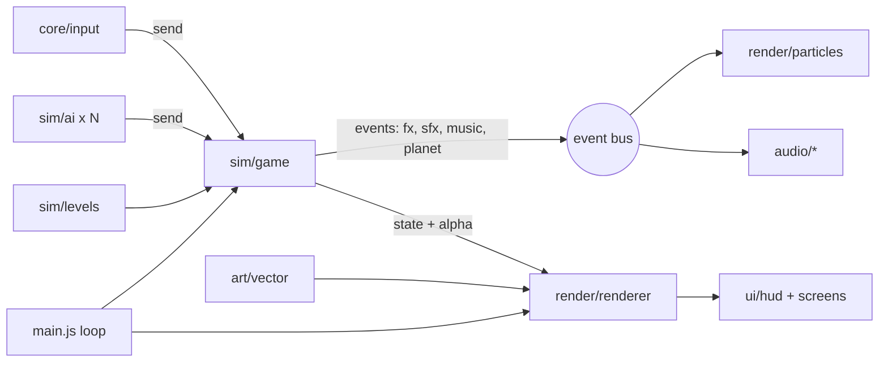

# Architecture overview

[Back to README](../README.md) | Binding contract: [ARCHITECTURE.md](../ARCHITECTURE.md)

Plain ES modules, no dependencies. `core/`, `sim/`, `art/` import in Node (no DOM at import time), so the whole simulation is testable and bot-playable headless. All sim randomness comes from a seeded `game.rng`, so replays are deterministic.

```
            +-----------+   input    +-----------+
 pointer -->| core/input|----------->|           |
 keyboard   +-----------+  g.send()  |  sim/game |<--- sim/ai (per rival)
                                     |  (fixed   |<--- sim/levels (data)
 +------------+  state, alpha        |  1/60 s)  |
 | render/    |<---------------------|           |
 | renderer   |<--- art/vector       +-----+-----+
 | particles  |                            | bus.emit(type, payload)
 | background |<---- fx events -------------+
 +------------+                            |
 +------------+<--- sfx/music events ------+
 | audio/     |
 | synthesized|     +------------+
 +------------+     | ui/ hud,   |  drawn on top of the canvas
                    | screens    |
                    +------------+
```



## Modules
| Module | Role |
|---|---|
| `src/core/defs.js` | Frozen constants: factions, tuning, difficulty, sprites, events |
| `src/sim/game.js`, `spatial.js` | Fixed-step simulation: planets, launch queues, ships, grid-based combat, capture, win/lose |
| `src/sim/ai.js` | Per-faction AI: defend, then scored expansion/offence by personality |
| `src/sim/levels.js` | 15 authored levels plus a seeded fair map generator |
| `src/sim/autopilot.js` | Wraps the AI to play the player side (bots, attract demo, QA) |
| `src/art/vector.js` | Neon vector sprites, planets and ships drawn with canvas paths |
| `src/render/*` | Letterboxed 960x540 canvas, batched ships, pooled particles, parallax background, CRT pass |
| `src/audio/*` | WebAudio synthesis: SFX layers rendered offline, 5 looping music tracks |
| `src/ui/*`, `src/main.js` | Menus, HUD, screens, game loop, URL params, settings and progress in localStorage |

## Data flow per frame
1. `main.js` accumulates real time and steps the game in fixed 1/60 s steps (scaled by speed).
2. Input and AI call `g.send(from[], to, pct)`; launches are queued and drain at a fixed rate.
3. The step moves ships, resolves combat through a spatial grid, applies arrivals, production and level-ups, then emits events.
4. The renderer draws with an interpolation alpha; particles and audio react to bus events.
