# Build timeline

[README](../README.md) · generated by `node tools/build-timeline.mjs` from the tracker snapshot in [`docs/swarm/tracker/`](swarm/tracker/) (the live dashboard data: `npm run tracker`).

**Wall-clock for the agent swarm: 7m 49s** (04:36:17 to 04:44:06 UTC). **11 agents**, 16m 36s of summed agent time (so about 2.1x parallelism). All agents ran on the `sonnet` tier.

```mermaid
gantt
    title Colbauralux swarm build (UTC, 2026-11-22)
    dateFormat HH:mm:ss
    axisFormat %H:%M
    section p2
    Sim core :sim_core, 04:36:17, 04:37:57
    Neon vector art :active, art_vector, 04:36:17, 04:37:28
    Renderer, particles, background :render, 04:36:17, 04:37:53
    Enemy AI :sim_ai, 04:36:17, 04:37:54
    Levels and generator :active, levels, 04:36:18, 04:37:32
    WebAudio synth :active, audio, 04:37:42, 04:38:22
    section p3
    App shell, input, HUD, screens :ui_shell, 04:37:43, 04:41:13
    Logo, icons, promo graphics :active, logo_icons, 04:38:02, 04:38:46
    Bot harness and balance :active, qa_bot, 04:38:06, 04:39:11
    section p4
    Documentation and GitHub Pages :docs_site, 04:41:33, 04:44:06
    section p5
    Integration and polish :active, integrate_qa, 04:42:04, 04:42:50
```

## Stages

| Stage | Agent | Model | Start | End | Duration | Result |
|---|---|---|---|---|---|---|
| p2 | Sim core (`sim-core`) | sonnet | 04:36:17 | 04:37:57 | 1m 40s | sim core + 13 tests pass |
| p2 | Neon vector art (`art-vector`) | sonnet | 04:36:17 | 04:37:28 | 1m 11s | vector.js + tests + sheet complete |
| p2 | Renderer, particles, background (`render`) | sonnet | 04:36:17 | 04:37:53 | 1m 35s | renderer/particles/background + 7 tests pass |
| p2 | Enemy AI (`sim-ai`) | sonnet | 04:36:17 | 04:37:54 | 1m 36s | AI+autopilot done; all personalities win 1v1 in <110s, tests green |
| p2 | Levels and generator (`levels`) | sonnet | 04:36:18 | 04:37:32 | 1m 14s | 15 levels, generator, validator; 7 tests pass |
| p2 | WebAudio synth (`audio`) | sonnet | 04:37:42 | 04:38:22 | 41s | audio ported, 6 tests pass |
| p3 | App shell, input, HUD, screens (`ui-shell`) | sonnet | 04:37:43 | 04:41:13 | 3m 30s | UI shell built; 14 tests pass; title/play/win/levels shots clean |
| p3 | Logo, icons, promo graphics (`logo-icons`) | sonnet | 04:38:02 | 04:38:46 | 44s | brand kit generated by tools/make-icons.mjs |
| p3 | Bot harness and balance (`qa-bot`) | sonnet | 04:38:06 | 04:39:11 | 1m 05s | botplay + tests + BALANCE.md; L12 unwinnable, L4/6/9/14 <50% |
| p4 | Documentation and GitHub Pages (`docs-site`) | sonnet | 04:41:33 | 04:44:06 | 2m 34s | docs, site, shots, pages workflow complete |
| p5 | Integration and polish (`integrate-qa`) | sonnet | 04:42:04 | 04:42:50 | 46s | all gates green |

## What the tracker does not show

- Orchestrator work before the first agent started: scaffolding with game-factory, copying the Omega Ratrace reference art, writing `ARCHITECTURE.md`, `defs.js` and `SWARM.md`.
- Follow-up agents resumed outside the tracker: the balance retune (levels 2-14, per-AI difficulty override) and the cheese-wheel art polish. They are recorded in [BALANCE.md](BALANCE.md) and the agent reports under [swarm/reports/](swarm/reports/).
- Orchestrator integration work after the swarm: output-file rename, site links, final gates, commit and push.
